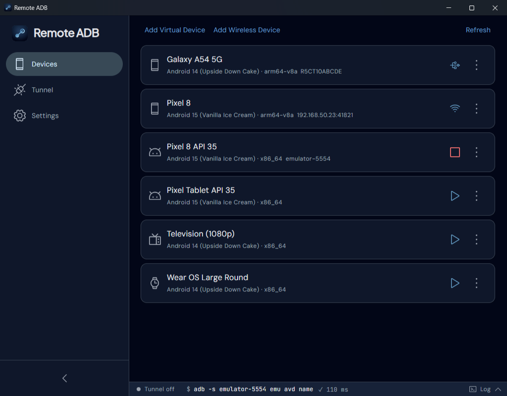
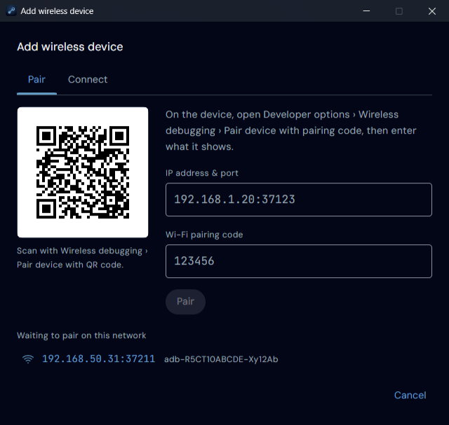
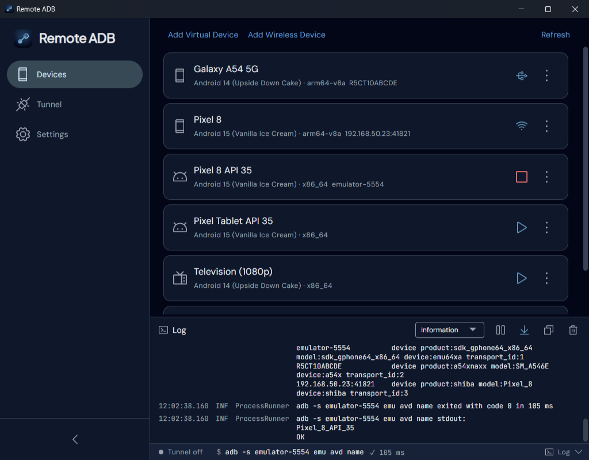

# Remote.Adb

[](https://github.com/ccswe-apps/Remote.Adb/actions/workflows/dotnet-build-app.yml)
[](https://github.com/ccswe-apps/Remote.Adb/releases/latest)
[](LICENSE.md)

A cross-platform desktop app (with a matching console) that bridges Android development between your
local workstation and a remote dev machine: it opens the SSH reverse tunnel that lets a remote `adb`
reach your locally-attached devices and emulators, and manages those emulators along the way.



## Why this exists

I moved my day-to-day development to a remote Linux machine, but my Android phones (plugged in over
USB) and emulators still live on my local Windows workstation. The remote machine's `adb` — and the
IDE running on it — can't see those devices.

The fix is to run the `adb` server **locally** (where the devices are) and open an SSH **reverse**
tunnel so the remote's `adb` connects back through it to the local server. That worked as a pile of
shell scripts, but it was fiddly to start, easy to get wrong, and didn't help with emulators.
Remote.Adb turns that workflow into one app — and folds in emulator management and device listing
while it's there.

## What it does

1. **SSH reverse tunnel** — opens `ssh -N -R <remote>:127.0.0.1:<local> <host>` so the remote dev
   host's `adb` reaches your local `adb` server, with the kill-then-bind-then-retry handling the old
   script learned the hard way. Detects when the tunnel drops or the local server dies underneath it
   (instead of looking healthy) and **auto-reconnects with backoff**, only faulting if it can't recover.
   Can also connect automatically on launch.
2. **Emulator management** — list, start, stop, create, view/edit, and delete Android Virtual Devices.
3. **Devices** — lists the devices `adb` currently sees (`adb devices -l`), and connects devices over the
   network: pair an Android 11+ device by scanning a QR code or entering its pairing code, connect by `ip:port` or
   pick a device discovered on your network, or switch a USB-connected device over to Wi-Fi.
   Connections go through your local `adb` server, so they're visible on the remote host through the tunnel,
   and addresses you connect by hand are reconnected automatically after `adb` restarts.

> **Status:** all three pillars — the SSH tunnel, emulator management, and network device connection — are working.
> See [`docs/ROADMAP.md`](docs/ROADMAP.md) for what's next.

## Requirements

Run Remote.Adb on the machine that has your Android devices and emulators and the `adb` server —
typically your **local workstation**. **Windows and Linux** are tested; the macOS builds are published but
untested (best-effort).

- Nothing to install for .NET itself: the release builds are self-contained. (Building from source needs the
  [.NET SDK](https://dotnet.microsoft.com/download) for the target framework in
  [`src/Directory.Build.props`](src/Directory.Build.props).) On Linux, the ICU library (`libicu`) must be present —
  it is on standard desktop distributions.
- The **Android SDK** — `adb` and `emulator` are found via `ANDROID_HOME`/`ANDROID_SDK_ROOT`, the
  platform default (e.g. `%LOCALAPPDATA%\Android\Sdk`), or an override you set in the app. Emulator
  creation also uses `avdmanager` from the `cmdline-tools`, which needs a JDK (`JAVA_HOME` or the app's JDK setting).
- An **OpenSSH client** (`ssh`) on your `PATH` (the built-in Windows OpenSSH is fine).
- **Key-based SSH access to the remote host that works non-interactively.** The tunnel runs `ssh`
  in `BatchMode` — it will not answer a password or passphrase prompt — so load your key into an
  ssh-agent (or use a passphraseless key); [Troubleshooting](#troubleshooting) shows how to check it. A first-seen
  host key is trusted automatically (`StrictHostKeyChecking=accept-new`).
- On the **remote host**: `ssh`, `pkill`, and the dev-side `adb` client (the side that connects
  through the tunnel) — the **same platform-tools version** as your local `adb`.

## Install & run

Download the latest build for your platform and extract it anywhere — each archive contains both the desktop app
(`Remote.Adb.Desktop`) and the console (`Remote.Adb.Console`), with the .NET runtime bundled:

- **Windows (x64):** [`Remote.Adb-win-x64.zip`](https://github.com/ccswe-apps/Remote.Adb/releases/latest/download/Remote.Adb-win-x64.zip)
- **Linux (x64):** [`Remote.Adb-linux-x64.tar.gz`](https://github.com/ccswe-apps/Remote.Adb/releases/latest/download/Remote.Adb-linux-x64.tar.gz)
- **macOS (Apple Silicon):** [`Remote.Adb-osx-arm64.tar.gz`](https://github.com/ccswe-apps/Remote.Adb/releases/latest/download/Remote.Adb-osx-arm64.tar.gz)
- **macOS (Intel):** [`Remote.Adb-osx-x64.tar.gz`](https://github.com/ccswe-apps/Remote.Adb/releases/latest/download/Remote.Adb-osx-x64.tar.gz)

(Or browse the [Releases page](https://github.com/ccswe-apps/Remote.Adb/releases); `SHA256SUMS.txt` there lists
each archive's checksum.) The builds aren't code-signed:

- **Windows:** SmartScreen may warn about an unrecognized app the first time — choose **More info › Run anyway**.
- **macOS:** clear the download quarantine first: `xattr -dr com.apple.quarantine <extracted folder>`.

Each archive includes `LICENSE.md`, `THIRD-PARTY-NOTICES.txt`, and the bundled components' license texts.

Or build from source:

```bash
# Build (Release)
dotnet build src/Remote.Adb.slnx --configuration Release

# Run the desktop app
dotnet run --project src/Remote.Adb.Desktop

# Run the console
dotnet run --project src/Remote.Adb.Console -- tunnel
```

## Using it

### Desktop

- **Tunnel** — enter the remote host (and, if needed, the remote/local ports), then **Connect**. The local port must
  match your local `adb` server's port — 5037 unless you set `ANDROID_ADB_SERVER_PORT`. *Connect automatically at
  launch* is on by default, so once a host is saved the tunnel comes up with the app; turn it off to connect by
  hand. The status card shows the live state (and the real `ssh` error if it can't connect),
  and a **Restart adb** action bounces the local `adb` server without dropping the tunnel.
- **Devices** — your AVDs with their running state (start/stop/create/edit/delete) and the physical devices `adb`
  currently sees, in one list auto-refreshed while the page is open.
  - **Add Wireless Device** — *Pair* an Android 11+ device: on the phone open Developer options › Wireless
    debugging › *Pair device with QR code* and scan the code the dialog shows, or *Pair device with pairing code*
    and enter the IP address & port and the code it shows. Once paired
    it connects automatically (if it doesn't, the dialog asks for the IP address & port shown on the Wireless
    debugging screen). Or *Connect* directly to a paired device or one in `adb tcpip` mode by `ip[:port]` — those
    addresses are remembered and reconnected whenever the local `adb` server restarts or the tunnel comes back up.
    Each tab also lists the matching devices found on your network (over mDNS) — pick one instead of typing its
    address. Discovery needs this computer on the phone's network with UDP port 5353 allowed for `adb` through the
    firewall; the dialog says so when it isn't available.

    

  - A wireless device's **⋮** menu has **Disconnect**, which also stops it being reconnected.
  - A USB device's **⋮** menu has **Enable Wi-Fi debugging**: it reads the phone's Wi-Fi address, switches it to
    `adb tcpip 5555`, and connects to it over Wi-Fi (remembered for reconnects) — then you can unplug it. The phone
    must be on the same Wi-Fi network as this computer.
- **Status bar & log** — the strip along the bottom of the window shows the tunnel's state, the last command the
  app ran (with its exit status and duration), and a badge counting warnings/errors you haven't seen. Click it to
  open the **log panel**: every `adb`/`ssh`/`emulator` command the app runs (exit code, duration, and output) plus
  the app's own log, with a level filter, pause, follow, copy, and clear. Drag its top edge to resize; its
  open state and height are remembered. Routine background polling (the device list's auto-refresh) is left out
  so the log shows what *you* did.

  

App settings (the remote host and ports, SDK/JDK/AVD-home overrides, theme/density, the log panel's state, remembered
wireless addresses) are persisted to `Remote.Adb/settings.json` under your app-data folder
(`%APPDATA%` on Windows; `~/.config` on Linux and macOS, or `$XDG_CONFIG_HOME` when set). Set the
`REMOTE_ADB_SETTINGS` environment variable to a file path to use a different settings file instead — handy for trying
things out without touching your real settings (the desktop app and the console both honor it).

### Console

```bash
# Open the tunnel (host falls back to the saved setting); Ctrl+C closes it
dotnet run --project src/Remote.Adb.Console -- tunnel [host]

# Emulators
dotnet run --project src/Remote.Adb.Console -- emulator list
dotnet run --project src/Remote.Adb.Console -- emulator start <avd-name>

# Wireless devices (pair prompts for the code so it stays out of your shell history)
dotnet run --project src/Remote.Adb.Console -- wireless pair 192.168.1.20:37123
dotnet run --project src/Remote.Adb.Console -- wireless connect 192.168.1.20:41235
dotnet run --project src/Remote.Adb.Console -- wireless disconnect 192.168.1.20:41235
dotnet run --project src/Remote.Adb.Console -- wireless enable R58M123ABC     # USB device → Wi-Fi
```

Run the console with no arguments for the full command list. Add `--verbose` to any command to print each tool it
runs and that tool's output.

### Troubleshooting

Start with the desktop app's **log panel** (click the status bar): it shows every `adb`/`ssh`/`emulator` command the
app ran with its exit code and output, including the real `ssh` error. The console's `--verbose` prints the same.

- **The tunnel won't connect.** The tunnel's `ssh` can't answer prompts, so check that `ssh <host> echo ok` prints
  `ok` without asking for a password or passphrase. Make sure the tunnel's local port matches your local `adb`
  server's port (5037 unless `ANDROID_ADB_SERVER_PORT` is set).
- **The remote `adb` can't use the forwarded server** (it reports that the server version doesn't match the client
  and tries to restart it). The remote `adb` must be the same platform-tools version as the local one: a mismatched
  client asks the server to `kill-server`, and the app's server refuses — that refusal is what keeps your local
  devices from being dropped. Update platform-tools on whichever side is older.
- **No wireless devices are discovered.** mDNS discovery needs this computer on the same LAN as the phone, with
  UDP port 5353 allowed for `adb` through the firewall. You can still connect by `ip:port`.
- **Windows SmartScreen blocks the app** — expected for an unsigned build; see [Install & run](#install--run).

---

## Development

Contributions and local hacking start here.

### Tech stack

- **.NET** / C# — target framework in `src/Directory.Build.props`, SDK pinned via `global.json`
- **[Avalonia](https://avaloniaui.net/)** for the cross-platform desktop UI
- **MVVM** via [CommunityToolkit.Mvvm](https://learn.microsoft.com/dotnet/communitytoolkit/mvvm/) (`[ObservableProperty]`, `[RelayCommand]` source generators)
- **[.NET Generic Host](https://learn.microsoft.com/dotnet/core/extensions/generic-host)** — the desktop head boots through **CCSWE.Avalonia.Hosting**, which wraps Avalonia's `AppBuilder` in the host so DI, configuration, and lifetime are wired the standard way
- **CCSWE.Avalonia.ViewLocator** — a source generator builds the view-model → view map at compile time (no reflection); **CCSWE.Avalonia.Material** supplies the Material 3 theme, type scale, and controls
- **[Microsoft.Extensions.DependencyInjection](https://learn.microsoft.com/dotnet/core/extensions/dependency-injection)** wiring the shared services into both front-ends
- Solution-wide `ImplicitUsings=enable`, `Nullable=enable`
- [Central Package Management](https://learn.microsoft.com/nuget/consume-packages/central-package-management) — versions live in `src/Directory.Packages.props`
- Versioning derived from git history via [Nerdbank.GitVersioning](https://github.com/dotnet/Nerdbank.GitVersioning)

### Projects

The solution is `src/Remote.Adb.slnx`:

- **`Remote.Adb.Core`** — class library with all domain logic (models, services, DI registration). Both front-ends depend on it; no UI dependency.
- **`Remote.Adb.Desktop`** — the Avalonia desktop GUI (`WinExe`).
- **`Remote.Adb.Console`** — the command-line front-end.
- **`Remote.Adb.Core.UnitTests`** / **`Remote.Adb.Desktop.UnitTests`** / **`Remote.Adb.Console.UnitTests`** — NUnit tests (plain NUnit + Moq; UI types sit behind seams so no Avalonia.Headless is needed).

```bash
dotnet test src/Remote.Adb.slnx
```

### Architecture

All functionality lives in **`Remote.Adb.Core`**; the desktop GUI and console are thin front-ends that
compose a DI service provider (`AddRemoteAdbCore()`) and drive the same services. Core and Desktop are
organized **feature-first** (Core: `Adb/`, `Diagnostics/`, `Emulators/`, `Logging/`, `Settings/`, `Tunnel/`; Desktop:
`Devices/`, `Logging/`, `Settings/`, `Shell/`, `Theming/`, `Tunnel/`), with `Common/` for cross-feature plumbing and
Desktop's `Assets/` (app icon) and `Themes/` (shared XAML resources).

Logging goes through `ILogger<T>` everywhere. The desktop host adds an in-memory `ILogStore` provider
(`AddRemoteAdbLogStore()`) that the status bar and log panel read; `ProcessRunner` logs every external command it
runs, and automatic polling runs inside `CommandLogScope.Background()` so it logs at Debug and stays out of the panel.

The desktop app follows Avalonia's MVVM conventions:

- `Program.Main` builds a `DesktopApplication` host (`DesktopApplication.CreateBuilder<App>`), registers services, and runs it — the host owns DI and the classic desktop lifetime. `BuildAvaloniaApp()` mirrors the same configuration (minus the host) for the XAML previewer; developer tools are added only in `DEBUG`.
- `App.OnFrameworkInitializationCompleted` is the composition root — the host injects the service provider, then the app applies the persisted theme/density and resolves the main window from DI.
- **View resolution is convention-based** via a source-generated `ViewLocator`: a `[GenerateViewLocator(typeof(ViewModelBase))]` partial class is filled in at compile time, mapping each `FooViewModel` to the `FooView` in the **same namespace** (matching the feature-first layout) and resolving the view from DI. View models must derive from `ViewModelBase`.
- **Compiled bindings are on by default** — XAML bindings need a declared `x:DataType`, and binding errors surface at compile time.
- View models and services stay UI-free: anything that would touch an Avalonia control or threading primitive goes behind a `Common/` abstraction with a UI-side adapter (e.g. `ITimerFactory`, `INotificationSink`, `IUiDispatcher`), keeping them unit-testable with plain NUnit + Moq.

To add a screen: in the relevant feature folder of `Remote.Adb.Desktop`, create `FooView.axaml` (+ `.axaml.cs`) and `FooViewModel.cs` (deriving from `ViewModelBase`), and register the view in DI; the generated `ViewLocator` wires them together by name. Domain models and services belong in the matching feature folder of `Remote.Adb.Core`.

### SSH/adb gotchas the tunnel handles

The reverse-tunnel workflow has a few non-obvious requirements the implementation bakes in:

- The reverse tunnel is `ssh -o ExitOnForwardFailure=yes -N -R <remote>:127.0.0.1:<local> <host>`. `ExitOnForwardFailure` turns a silent bind failure into a visible non-zero exit.
- Kill the remote `adb` with `pkill -x adb`, **not** `adb kill-server` — `kill-server` does a localhost network round-trip that can hang on a stale/forwarded `127.0.0.1` port.
- Use the literal `127.0.0.1` (not `localhost`) for the forward target — Windows OpenSSH may resolve `localhost` to IPv6 `::1`, but the Windows `adb` server binds only IPv4, causing refused connections.
- A remote IntelliJ Android plugin respawns `adb` on Gradle sync and races the bind — hence the kill-then-bind-then-retry loop.

The app adds non-interactive `ssh` options (`BatchMode`, `ConnectTimeout`, `GSSAPIAuthentication=no`,
`StrictHostKeyChecking=accept-new`) so it never hangs on a prompt from a windowless GUI process.

It also protects the local `adb` server the tunnel forwards to:

- Every `adb` command the app runs goes through one shared runner (`IAdbRunner`) that sets `ADB_REJECT_KILL_SERVER=1`,
  so a server the app starts refuses `kill-server` — including one a remote `adb` of a different version sends through
  the tunnel, which would otherwise kill your local server and drop every device.
- Connecting the tunnel replaces a server started outside the app (e.g. by Android Studio), since that one wouldn't
  reject the kill. **Restart adb** stops the server by killing its process (it won't accept `kill-server` either).
- If you upgrade platform-tools while the app's server is running, the new `adb` can't replace the old server itself;
  the app notices, stops the old server, and retries.

### Releasing

Versioning is [Nerdbank.GitVersioning](https://github.com/dotnet/Nerdbank.GitVersioning) — `version.json`
sets the major.minor (plus an optional prerelease suffix such as `-rc`); the patch is the git height since that
version was set, so `1.0` ships as e.g. `v1.0.4`, not `v1.0.0`. To cut a release, let NBGV derive the tag from an
up-to-date `master` (on any other commit it adds a `-g<sha>` suffix, making it a prerelease):

```bash
git checkout master && git pull
dotnet tool restore
dotnet tool run nbgv tag      # creates v<major>.<minor>.<patch>[-suffix] for HEAD
git push origin <tag>          # e.g. git push origin v1.0.4
```

Pushing the `v*` tag triggers `.github/workflows/dotnet-release-app.yml` (the shared `ccswe-apps/actions` workflow with
`self-contained: true`), which publishes one self-contained archive per RID (`win-x64`/`linux-x64`/`osx-x64`/
`osx-arm64`), each containing the Desktop and Console plus the license files, and creates a GitHub Release with
auto-generated notes — marked as a prerelease when the tag has a suffix (e.g. `-rc`). Bump `version.json` (and commit)
when you want a new major/minor, or to drop the prerelease suffix.

## License

[MIT](LICENSE.md) © 2026 Cory Charlton
